# ⚡ Anirudha DG (`@anirudhadg04`)

> **Systems, Security & Full-Stack Engineer**  
> Building client-side cryptography sandboxes, mindful digital ecosystems, and high-performance web platforms.

  
  
  

<!-- 1. Live Dynamic Contribution Graph Terminal -->

  

<!-- 2. Dual Terminal Windows: ASCII Self-Portrait & Live Metrics -->

  
  

 

<!-- 3. Featured Engineering & Systems Projects -->
<h3>🚀 Featured Engineering & Systems Projects</h3>

  
  

  
  

 

<!-- 4. Core Tech Stack -->
<h3>🛠️ Core Competencies & Toolchain</h3>

  
  
  
  
  
  
  
  
  
  

---

  ⚡ Automated & refreshed daily via GitHub Actions · Custom SVG rendering with zero third-party widget dependencies

