# Anirudha DG (`@anirudhadg04`)

> **Student & Developer · Exploring Application Security & Systems**  
> Learning web application security, practicing CTF challenges and lab methodologies, and building practical software.

  
  
  

<!-- 1. Live Dynamic Contribution Graph Terminal -->

  

<!-- 2. Dual Terminal Windows: ASCII Self-Portrait & Live Metrics -->

  
  

 

<!-- 3. Featured Projects & Labs -->
<h3>🛡️ Featured Projects & Security Labs</h3>

  
  

  

 

<!-- 4. Learning & Toolchain -->
<h3>🛠️ Technologies & Tools I'm Learning & Using</h3>

  
  
  
  
  
  
  
  
  
  

---

  ⚡ Automated & refreshed daily via GitHub Actions · Custom SVG rendering with zero third-party widget dependencies

